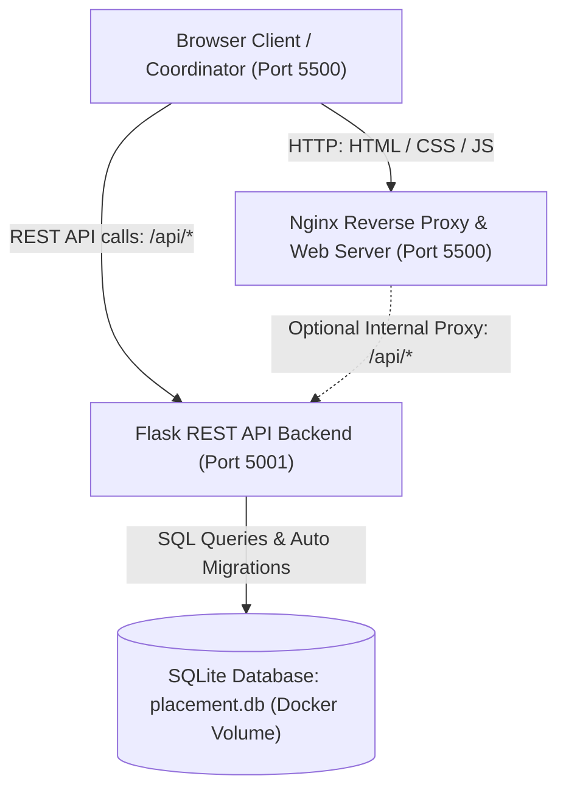

# College Placement Application Tracker

A centralized full-stack portal for college placement coordinators and students to manage job listings, student profiles, eligibility verification, job applications, and multi-stage interview scheduling.

---

## Architecture Overview



---

## Technology Stack

| Layer | Technology | Details |
| :--- | :--- | :--- |
| **Frontend** | HTML5, CSS3, JavaScript (Vanilla ES6) | Responsive dashboard, modals, real-time eligibility feedback |
| **Backend** | Python 3.11+, Flask 3.1 | Modular Blueprints, custom error handlers, input validators |
| **Database** | SQLite 3 (`placement.db`) | Automatic schema migrations, foreign keys, ACID compliance |
| **Web Server / Reverse Proxy** | Nginx Alpine | Serves frontend static files and reverse proxies API traffic |
| **Containerization** | Docker & Docker Compose | Multi-arch images supporting Apple Silicon (ARM64) & x86_64 |
| **Monitoring (Optional)** | Prometheus & Grafana | Pre-configured metrics scraping and dashboard visualization |

---

## Features

1. **Coordinator Dashboard**: Real-time stats on total students, open jobs, total applications, placement rate %, and status breakdowns.
2. **Student Management**: Add, view, edit, and delete student records with CGPA, backlogs, department, and skills.
3. **Job Listings**: Post and manage job openings with minimum CGPA, backlog thresholds, eligible branches, and deadlines.
4. **Eligibility Engine**: Real-time evaluation of a student's eligibility against company requirements before application submission.
5. **Application Management**: Submit job applications, track stages, withdraw applications with cascading interview cleanup.
6. **Status Tracking**: Visual progress stepper (`Applied` $\rightarrow$ `Shortlisted` $\rightarrow$ `Interview Scheduled` $\rightarrow$ `Selected` / `Rejected`).
7. **Interview Scheduling**: Schedule and reschedule online/offline interviews with automated time-clash detection.
8. **Placement Analytics**: Department-level placement rates and salary package distributions.
9. **Authentication**: Student registration, login with email or roll number, and coordinator authentication.

---

## Project Structure

```
placement-tracker/
├── .gitignore                     # Git ignore rules for venv, caches, logs, .env, and .db
├── docker-compose.yml             # Docker Compose orchestration (Backend, Frontend, Volumes)
├── README.md                      # Project documentation and setup guide
├── backend/                       # Python Flask REST API
│   ├── Dockerfile                 # Production Dockerfile (Python 3.11-slim, ARM64 ready)
│   ├── entrypoint.sh              # Container entrypoint with volume auto-seeding
│   ├── app.py                     # Flask entry point and CORS configuration
│   ├── config.py                  # Environment configuration
│   ├── database.py                # Database connection and schema migration engine
│   ├── errors.py                  # Centralized error handlers
│   ├── requirements.txt           # Python package dependencies
│   ├── services.py                # Business logic and eligibility rules
│   ├── store.py                   # SQL-backed data table abstractions
│   ├── validators.py              # Input validation and format normalization
│   ├── .env                       # Local environment settings (not committed to git)
│   ├── .env.example               # Template environment configuration
│   ├── routes/                    # API Route Blueprints
│   │   ├── __init__.py            # Blueprint registration
│   │   ├── applications.py        # /api/applications
│   │   ├── auth.py                # /api/auth (register, login, me)
│   │   ├── dashboard.py           # /api/dashboard (summary, analytics)
│   │   ├── eligibility.py         # /api/eligibility (check, job, student)
│   │   ├── interviews.py          # /api/interviews
│   │   ├── jobs.py                # /api/jobs
│   │   └── students.py            # /api/students
│   └── tests/                     # Automated Test Suite
│       └── test_api.py            # 41 unit and integration tests
├── frontend/                      # Web Client (Vanilla HTML/CSS/JS)
│   ├── Dockerfile                 # Production Dockerfile (Nginx Alpine)
│   ├── nginx.conf                 # Nginx server configuration with /api/ reverse proxy
│   ├── index.html                 # Admin Dashboard
│   ├── students.html              # Student Management
│   ├── jobs.html                  # Job Listings
│   ├── applications.html          # Student Applications
│   ├── eligibility.html           # Eligibility Verification
│   ├── interviews.html            # Interview Schedule
│   ├── status.html                # Application Status Tracking
│   ├── css/                       # Stylesheets
│   │   ├── style.css              # Core design system and layout
│   │   └── pages.css              # Page-specific components
│   └── js/                        # Client-side Logic
│       ├── api.js                 # API client wrapper
│       └── layout.js              # Shared sidebar, topbar, and toast utilities
└── prometheus/                    # Optional Monitoring Configuration
    └── prometheus.yml             # Prometheus scraper configuration
```

---

## Running with Docker Compose (Recommended)

### Prerequisites
- Docker Desktop installed and running.

### 1. Start Application Containers
Run the following command from the project root:
```bash
docker compose up -d
```

Docker will:
1. Build the backend image (`placement-tracker-backend`) and start on **port 5001**.
2. Build the frontend image (`placement-tracker-frontend`) and start on **port 5500**.
3. Create a persistent Docker volume (`backend-data`) so your database records remain safe across container restarts.

### 2. Access the Application
- **Frontend Web UI**: [http://localhost:5500](http://localhost:5500)
- **Backend API Health Check**: [http://localhost:5001/api/health](http://localhost:5001/api/health)
- **API Dashboard Summary**: [http://localhost:5001/api/dashboard/summary](http://localhost:5001/api/dashboard/summary)

### 3. Stopping Containers
```bash
# Stop containers while preserving database volume
docker compose down

# Stop containers and remove volume (caution: resets database)
docker compose down -v
```

---

## Running Locally without Docker

### 1. Setup Backend
```bash
cd backend
python3 -m venv venv
source venv/bin/activate
pip install -r requirements.txt
cp .env.example .env
python app.py
```
*Backend runs on `http://127.0.0.1:5001`.*

### 2. Setup Frontend
In another terminal:
```bash
cd frontend
python3 -m http.server 5500
```
*Frontend runs on `http://localhost:5500`.*

---

## Running Automated Tests

To run the complete test suite (41 tests covering authentication, CRUD operations, status workflows, eligibility checks, clash detection, and analytics):

```bash
cd backend
./venv/bin/python -m unittest discover -s tests -v
```

---

## Database Management & Git Handling

- **Database File (`placement.db`)**:
  - The SQLite database is deliberately excluded from Git via `.gitignore`.
  - Storing binary databases in Git causes merge conflicts, repository bloat, and security concerns.
  - In Docker, data persistence is guaranteed using a **Docker named volume** (`backend-data` mounted at `/app/data`).
  - When the container first starts, [backend/database.py](file:///Users/anjali/placement-tracker/backend/database.py) and [backend/store.py](file:///Users/anjali/placement-tracker/backend/store.py) automatically initialize tables and execute non-destructive schema migrations.

---

## API Endpoints Reference

| Category | Endpoint | Method | Description |
| :--- | :--- | :---: | :--- |
| **System** | `/api/health` | `GET` | Health status check |
| **Auth** | `/api/auth/register` | `POST` | Register a new student |
| | `/api/auth/login` | `POST` | Authenticate student or coordinator |
| | `/api/students/login` | `POST` | Student login alias |
| | `/api/auth/me` | `GET` | Get current user profile |
| **Dashboard** | `/api/dashboard/summary` | `GET` | Summary statistics and counters |
| | `/api/dashboard/analytics` | `GET` | Department and salary metrics |
| **Students** | `/api/students` | `GET` | List students (`?department=&q=`) |
| | `/api/students` | `POST` | Create a new student |
| | `/api/students/<id>` | `GET` | Get student details |
| | `/api/students/<id>` | `PUT` | Update student profile |
| | `/api/students/<id>` | `DELETE`| Delete student and cascade cleanup |
| **Jobs** | `/api/jobs` | `GET` | List jobs (`?status=&q=`) |
| | `/api/jobs` | `POST` | Create job listing |
| | `/api/jobs/<id>` | `GET` | Get job details |
| | `/api/jobs/<id>` | `PUT` | Update job listing |
| | `/api/jobs/<id>` | `DELETE`| Delete job listing |
| **Eligibility** | `/api/eligibility/check` | `GET` | Verify eligibility for student & job |
| | `/api/eligibility/job/<id>` | `GET` | List eligible students for a job |
| | `/api/eligibility/student/<id>`| `GET` | List eligible jobs for a student |
| **Applications**| `/api/applications` | `GET` | List applications (`?studentId=&jobId=&status=`) |
| | `/api/applications` | `POST` | Submit an application |
| | `/api/applications/<id>/status`| `PATCH` | Update status (with workflow validation) |
| | `/api/applications/<id>` | `DELETE`| Withdraw application |
| **Interviews** | `/api/interviews` | `GET` | List scheduled interviews |
| | `/api/interviews` | `POST` | Schedule an interview |
| | `/api/interviews/<id>` | `PUT` | Reschedule interview |
| | `/api/interviews/<id>` | `DELETE`| Cancel interview |